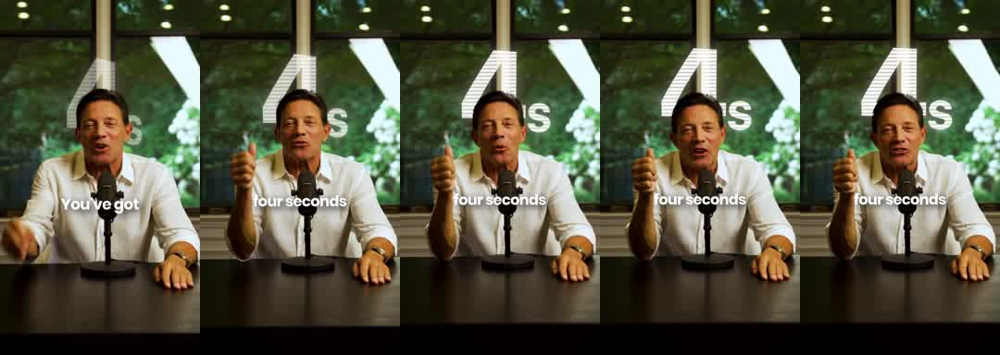

# v09_s03 · icon_overlay · 4.2–5.4s (calidad 4)

- **Guion:** You've got four seconds
- **Qué se ve:** 'You've got four seconds' — '4s' gigante detrás de la cabeza.
- **Diseño:** Estudio: mesa negra brillante, micrófono de podcast centrado, ventanal con vegetación detrás (no croma). Subtítulos centrados sobre el pecho.
- **Efectos:** Grade cálido-verdoso natural; franja negra inferior en algunos encuadres; sin grano ni viñeta añadida.
- **Animación:** Corte 4.13; '4s' fade-in 4.2→4.4 (a 'four' 4.50); sale ≈5.3.
- **Por qué aquí:** Dato (4 segundos) → número.
