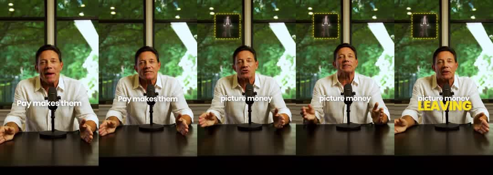

# v12_s03 · icon_overlay · 5.4–7.9s (calidad 4)

- **Guion:** pay makes them picture money leaving
- **Qué se ve:** [observado 6.0–7.5] Arriba-izquierda aparece un recuadro oscuro translúcido con borde discontinuo amarillo que contiene una figura de hombre en traje (foto recortada tipo holograma). Caption 'Pay makes them' / 'picture money' / 'LEAVING' amarillo.
- **Diseño:** Recuadro ~27 % del ancho, x≈15–42 %, y≈5.5–21 %, esquinas ligeramente redondeadas, fondo negro ~60 % opacidad, borde amarillo discontinuo fino. 'LEAVING' amarillo MAYÚSCULAS NO itálica ~4 % alto.
- **Efectos:** Glow/halo suave alrededor de la figura (inferido).
- **Animación:** [observado 6.07–6.27] el recuadro crece/aparece con fade en ~3 fr; queda fijo. 'LEAVING' aparece con revelado de letras (fade).
- **Por qué aquí:** [inferido] 'Picture' = literalmente un cuadro/imagen mental: el recuadro es la 'foto' que se forma en la cabeza del cliente.
