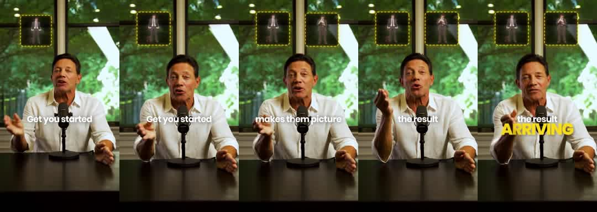

# v12_s04 · icon_overlay · 7.9–11.1s (calidad 5)

- **Guion:** get you started makes them picture the result arriving
- **Qué se ve:** [observado 9.0–10.5] Se suma un segundo recuadro igual, a la derecha del primero (x≈43–70 %, primero translúcido a 9.0, sólido a ~9.9). Caption 'Get you started' / 'makes them picture' / 'the result' + 'ARRIVING' amarillo.
- **Diseño:** Dos recuadros iguales con borde discontinuo amarillo en la franja superior (sobre la cabeza). 'ARRIVING' amarillo MAYÚSCULAS ~4.5 % alto.
- **Efectos:** Igual que s03.
- **Animación:** [observado 7.97] jump-cut de escala. [observado ~9.0→9.9] 2º recuadro entra con fade lento. [observado 10.4] 'ARRIVING' se revela por letras sueltas en orden aleatorio ('R V' → 'ARRIVIN' → 'ARRIVING') en ~0.3 s.
- **Por qué aquí:** [inferido] Contraste dos imágenes mentales: dinero que se va vs resultado que llega → dos 'cuadros' lado a lado.
