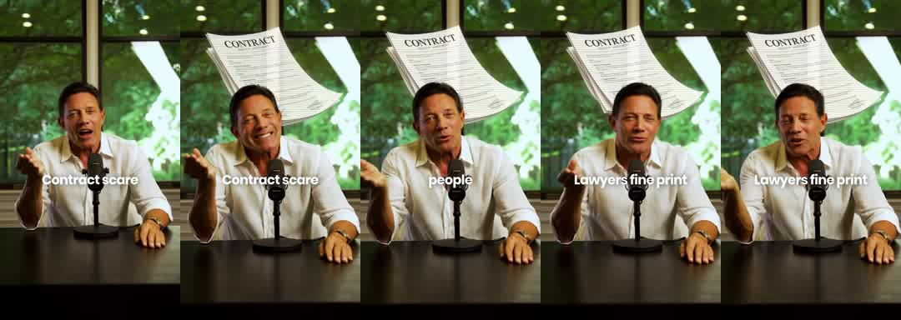

# v12_s06 · icon_overlay · 13.2–16.4s (calidad 4)

- **Guion:** contract scare people lawyers fine print
- **Qué se ve:** [observado 13.5–16.0] Un fajo de papeles 3D 'CONTRACT' flota arriba-izquierda sobre la cabeza, ligeramente girado. Caption 'Contract scare' / 'people' / 'Lawyers fine print'.
- **Diseño:** Objeto 3D de papel blanco con título serif 'CONTRACT', ~45 % del ancho, x≈10–55 %, y≈3–25 %, inclinado ~15°.
- **Efectos:** Sombra propia del render 3D; sin textura añadida.
- **Animación:** [observado 13.67–13.95] entra con fade + leve caída/rotación (~0.3 s); flota con micro-rotación; sale con el jump-cut a 16.52.
- **Por qué aquí:** [inferido] Literal: la palabra temida 'contract' se materializa amenazante sobre su cabeza.
