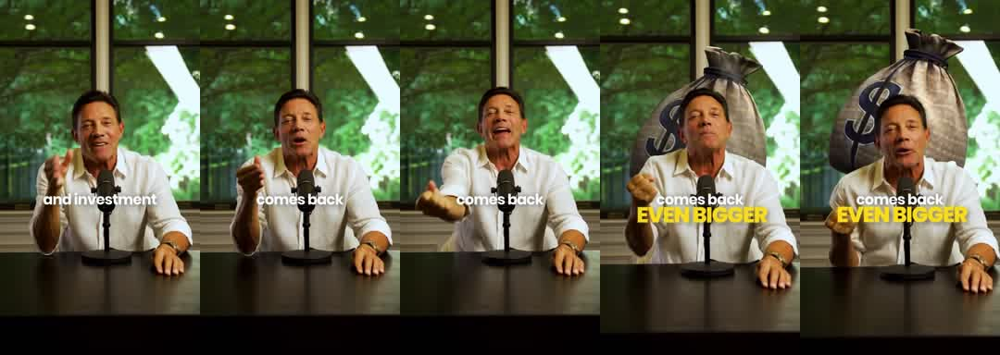

# v12_s11 · icon_overlay · 28.7–30.8s (calidad 5)

- **Guion:** investment comes back even bigger
- **Qué se ve:** [observado 30.0–30.9] Un saco de dinero 3D gris con símbolo '$' aparece detrás/izquierda de su cabeza. Caption 'comes back' + 'EVEN BIGGER' amarillo.
- **Diseño:** Saco 3D ~45 % del ancho, x≈12–58 %, y≈2–45 % (sobre la cabeza y hombro izq.). 'EVEN BIGGER' amarillo MAYÚSCULAS ~4.5 % alto.
- **Efectos:** Render 3D con sombras propias; aparece por detrás de la silueta (recorte del sujeto, inferido por solape con la cabeza).
- **Animación:** [observado 30.33–30.5] el saco crece de pequeño a grande con fade (~0.2 s) en 'bigger'; 'EVEN BIGGER' blur-in a la vez. Sale en seco con el jump-cut 31.03.
- **Por qué aquí:** [inferido] Literal + escala: 'bigger' = el objeto crece.
