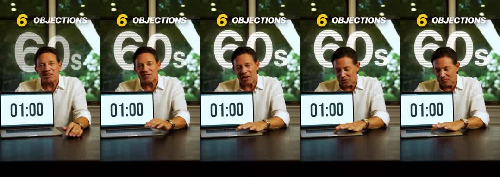

# v14_s02 · icon_overlay · 1.2–2.2s (calidad 5)

- **Guion:** 60 seconds,
- **Qué se ve:** [observado 1.2–2.2] Detrás de Jordan aparece '60s' gigante blanco/gris semitransparente que su cabeza tapa (texto detrás del sujeto).
- **Diseño:** '60s' sans bold gigante ~25 % alto, ~85 % ancho, x 5–95 %, y≈10–35 %, blanco con transparencia (~70 %); la 's' más pequeña.
- **Efectos:** Recorte del sujeto (texto entre fondo y persona, inferido por oclusión de la cabeza a 1.5).
- **Animación:** [observado 1.37–1.6] fade-in + leve escala ~0.25 s; sale con el jump-cut 2.25.
- **Por qué aquí:** [inferido] El límite de tiempo es el gancho: se hace monumental y 'detrás' de él para no tapar la cara.
