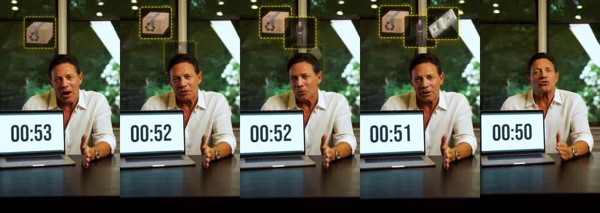

# v14_s06 · icon_overlay · 7.7–9.5s (calidad 5)

- **Guion:** The product, me, or the money?
- **Qué se ve:** [observado 7.87–9.3] Aparecen uno tras otro tres recuadros con borde discontinuo amarillo en la franja superior: caja de cartón (product), foto de Jordan (me), fajo de billetes (money).
- **Diseño:** Recuadros ~12 % ancho cada uno, fondo oscuro translúcido, borde amarillo discontinuo; #1 x≈5–17 % y≈3–10 %; #2 x≈20–33 % y≈8–16 %; #3 x≈34–47 % y≈12–20 % (escalera diagonal).
- **Efectos:** Ninguno.
- **Animación:** [observado 7.87, 8.50, 8.95] cada recuadro entra con fade+escala ~0.2 s en su palabra; salen juntos en el jump-cut 9.38.
- **Por qué aquí:** [inferido] Literal: una imagen por cada opción enumerada.
