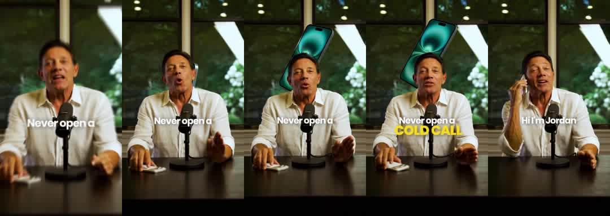

# v18_s01 · icon_overlay · 0.0–2.3s (calidad 5)

- **Guion:** Never open a cocoa with hi,
- **Qué se ve:** [observed 0.0–1.5] Look B: estudio con micrófono de mesa negro, mesa negra, ventanal con jardín desenfocado detrás, camisa blanca. Primer frame desenfocado (blur-in). Un smartphone 3D turquesa entra rotando por detrás/encima de su cabeza (0.57–1.0). Subtítulo 'Never open a' blanco + 'COLD CALL' amarillo mayúsculas (corrige el 'cocoa' de la transcripción).
- **Diseño:** Blanco bold sans geométrica (Poppins-like) ≈2.5 % alto, y≈59 %; amarillo #F5DC2E aprox. MAYÚSCULAS ≈5.5 % alto, y≈64 %, ancho ≈60–80 %. Teléfono 3D ≈25 % ancho, x≈55–75 %, y≈5–25 %, inclinado ≈30°.
- **Efectos:** Grado cálido con negros profundos, fondo desenfocado, leve viñeta; franja negra inferior ≈5 % (el A-roll no llena el 9:16).
- **Animación:** [observed] Blur-in 0.0→0.14 s; teléfono entra desde detrás de la cabeza con rotación+escala ≈0.4 s; 'COLD CALL' write-on por letras 1.14→1.29.
- **Por qué aquí:** [inferred] Hook: prohibición ('Never') + objeto literal (teléfono = llamada en frío).
