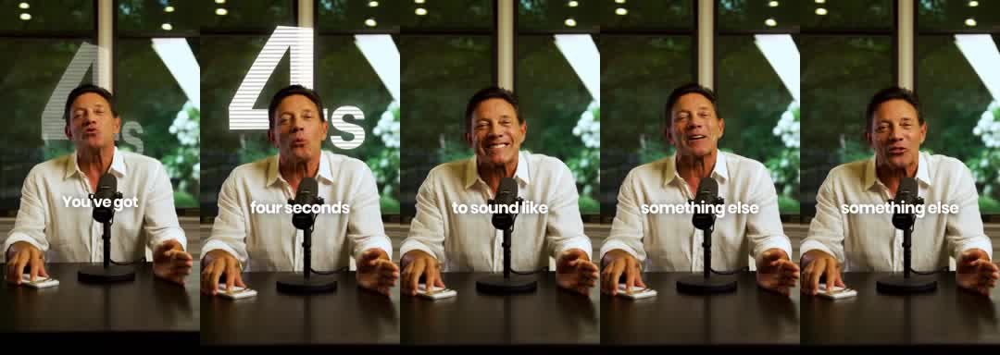

# v18_s07 · icon_overlay · 14.4–17.6s (calidad 5)

- **Guion:** You've got four seconds to sound like something else,
- **Qué se ve:** [observed 14.44–17.6] Vuelta al A-roll; detrás de su cabeza un '4s' gigante blanco con textura de rayas horizontales.
- **Diseño:** '4' ≈35 % ancho, 's' pequeña a la derecha; x≈20–75 %, y≈3–25 %, detrás de la cabeza (máscara: la cabeza tapa el número).
- **Efectos:** Rayas horizontales tipo scanline en el número; semitransparencia.
- **Animación:** [observed] Aparece con fade+escala ≈0.15–0.3 s al corte (14.44).
- **Por qué aquí:** [inferred] Dato: el número se convierte en objeto.
