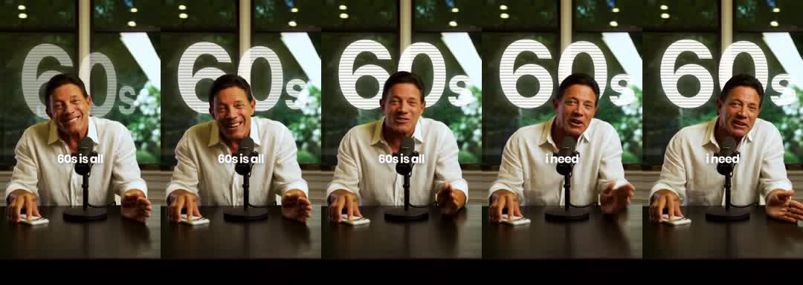

# v18_s14 · icon_overlay · 33.3–34.6s (calidad 5)

- **Guion:** 60 seconds is all I need.
- **Qué se ve:** [observed 33.2–34.7] '60s' gigante blanco rayado detrás de su cabeza; subtítulo '60s is all', 'i need'.
- **Diseño:** '60' ≈75 % ancho, x≈5–95 %, y≈3–25 %.
- **Efectos:** Rayas horizontales, semitransparente.
- **Animación:** [observed] Fade-in 33.2→33.53 (≈0.3 s); sale con el corte 34.70.
- **Por qué aquí:** [inferred] Dato numérico → objeto gigante (eco del '4s').
