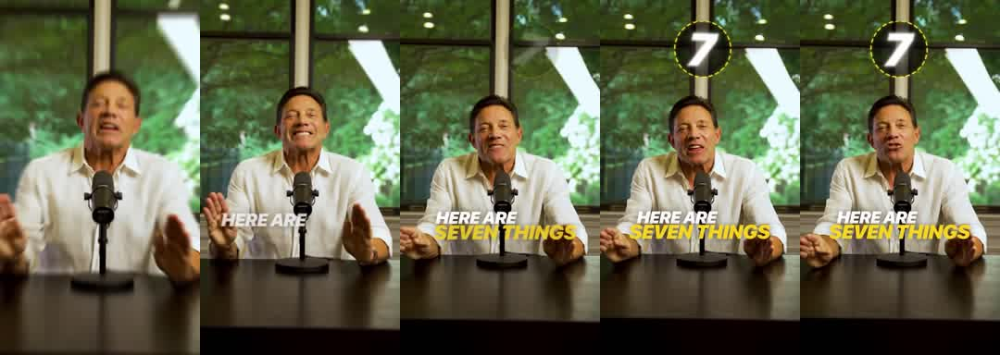

# v20_s01 · icon_overlay · 0.0–1.6s (calidad 5)

- **Guion:** Here are seven things
- **Qué se ve:** [observed 0.0–2.0] Look B: estudio con micro de mesa negro, ventanal con árboles verdes detrás (luz de día), camisa blanca. Sobre su cabeza una moneda/insignia oscura con aro discontinuo amarillo y un '7' blanco en itálica. Subtítulo 'HERE ARE' blanco + 'SEVEN THINGS' amarillo, ambos en mayúsculas itálicas.
- **Diseño:** 'HERE ARE' blanco bold itálica mayúsculas ≈3.2 % alto, y≈61 %; 'SEVEN THINGS' amarillo #F5D82E aprox. bold itálica mayúsculas ≈4.5 %, y≈65 %; bloque ligeramente a la izquierda (x≈15–85 %). Icono '7' ≈28 % ancho, x≈38–66 %, y≈2–22 %.
- **Efectos:** Grado natural luminoso (verdes #2F3115/#4E4D31), negros de la mesa profundos; sin textura. Icono con glow leve.
- **Animación:** [observed] Icono '7' aparece rotando/girando como moneda 0.4–0.8, se mantiene hasta ≈2.0 y sale girando (2.0 se ve de canto). Texto amarillo write-on por letras ≈0.4–0.8.
- **Por qué aquí:** [inferred] Hook de listicle: el número promete una estructura cerrada; el icono hace 'objeto' del número.
