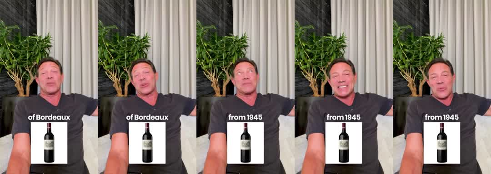

# v01_s03 · insert_image · 7.7–9.7s (calidad 4)

- **Guion:** Bordeaux from 1945
- **Qué se ve:** Debajo del subtítulo 'of Bordeaux' → 'from 1945' aparece foto de producto: botella de Bordeaux con etiqueta clara sobre fondo blanco. (observado 7.77–9.75)
- **Diseño:** Recuadro rectangular de esquinas rectas sin borde, fondo blanco de la propia foto; centro (50 %, 82 %), ancho ~37 % del ancho, alto ~24 % (y 70–94 %), pegado justo debajo del subtítulo.
- **Efectos:** Foto de catálogo recortada, sin sombra ni grado.
- **Animación:** Aparece en 1 frame a 7.767 (corte seco, sin escala), 0.1 s ANTES de 'Bordeaux' (7.86); sale seco a ~10.03 al cambiar a la foto siguiente. Dura ~2.3 s.
- **Por qué aquí:** Literal: nombra el vino → se ve la botella; prueba visual del lujo (inferido).
