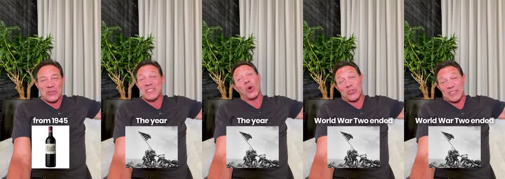

# v01_s04 · insert_image · 9.7–11.4s (calidad 4)

- **Guion:** via World War II ended.
- **Qué se ve:** Foto B/N icónica de soldados alzando la bandera (Iwo Jima) bajo los subtítulos 'The year' → 'World War Two ended'. (observado 10.0–11.5)
- **Diseño:** Recuadro rectangular sin borde, fondo gris claro de la foto; centro (50 %, 81 %), ancho ~52 %, y 70–93 %.
- **Efectos:** Foto de archivo B/N sin tratamiento extra.
- **Animación:** Sustituye a la botella con corte seco a ~10.07 (detector de cambio 10.067); sale seco a 11.57 junto al jump cut. Dura ~1.5 s.
- **Por qué aquí:** Dato/época: '1945, el año que acabó la 2.ª Guerra Mundial' → imagen histórica universal para anclar la antigüedad del vino (inferido).
