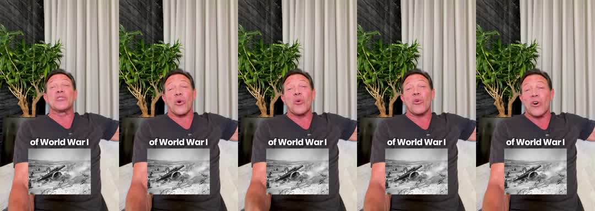

# v01_s06 · insert_image · 15.9–17.5s (calidad 4)

- **Guion:** of World War I.
- **Qué se ve:** Foto B/N de artillería en campo de batalla de la 1.ª Guerra Mundial bajo 'of World War I'. (observado 16.0–17.6)
- **Diseño:** Recuadro rectangular sin borde; centro (50 %, 81 %), ancho ~52 %, y 70–93 %.
- **Efectos:** Foto de archivo B/N, sin tratamiento.
- **Animación:** Entra seco a 15.93 (0.15 s antes de 'World' 16.08); sale seco con jump cut a 17.63. Dura ~1.7 s.
- **Por qué aquí:** Literal/época, repite el patrón del 1945 para que la 2.ª botella se sienta aún más vieja (inferido).
