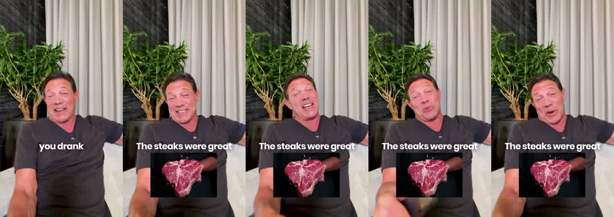

# v01_s09 · insert_image · 29.1–30.2s (calidad 3)

- **Guion:** Steaks were great,
- **Qué se ve:** Foto de un chuletón crudo (T-bone marmoleado) sobre fondo negro bajo 'The steaks were great'. (observado 29.33–30.17)
- **Diseño:** Recuadro cuadrado sin borde, fondo negro de la propia foto; centro (50 %, 80 %), ancho ~54 %, y ~70–90 %.
- **Efectos:** Ninguno.
- **Animación:** Entra seco a 29.27 (0.2 s después de 'Steaks' 29.06); sale seco a 30.37. Dura ~1.1 s.
- **Por qué aquí:** Literal: comida cara nombrada → imagen (inferido).
