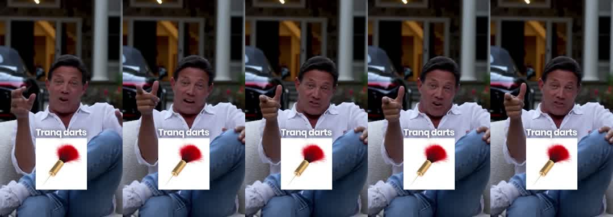

# v06_s05 · insert_image · 23.6–24.3s (calidad 4)

- **Guion:** Trank darts,
- **Qué se ve:** Aparece foto recortada de un dardo tranquilizante (pluma roja, cuerpo dorado) sobre cuadrado blanco bajo el subtítulo 'Tranq darts'. Él señala a cámara.
- **Diseño:** Subtítulo blanco Poppins-like bold centrado a ~61 % del alto; sin palabra destacada ni amarillo. Recuadro cuadrado blanco con el objeto centrado.
- **Efectos:** Sin texturas añadidas; grade natural cálido de atardecer (fondo #090705/#302F2E, piel cálida, camisa blanca ligeramente azulada #AAB2D1); fondo desenfocado por profundidad de campo (casa con columnas blancas, coche negro). La foto es un producto sobre fondo blanco puro, sin sombra ni borde.
- **Animación:** Entra por corte (1 frame, 23.43 s) sin escala ni fade; se reemplaza por la foto del cattle prod en 24.47.
- **Por qué aquí:** Literal: nombra el objeto absurdo → lo enseña; refuerza el humor.
