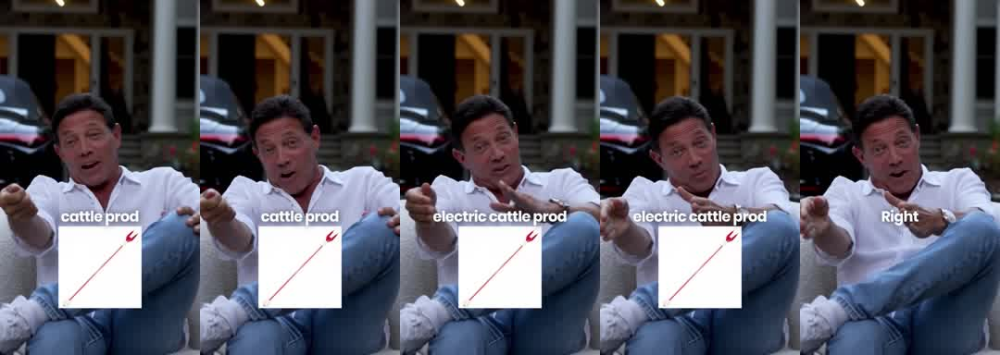

# v06_s06 · insert_image · 24.5–26.5s (calidad 4)

- **Guion:** cattle prod, electric cattle prod, right?
- **Qué se ve:** Swap a foto de una picana de ganado (vara roja larga en diagonal) en el mismo cuadrado blanco; subtítulo 'cattle prod' → 'electric cattle prod'.
- **Diseño:** Subtítulo blanco Poppins-like bold centrado a ~61 % del alto; sin palabra destacada ni amarillo.
- **Efectos:** Sin texturas añadidas; grade natural cálido de atardecer (fondo #090705/#302F2E, piel cálida, camisa blanca ligeramente azulada #AAB2D1); fondo desenfocado por profundidad de campo (casa con columnas blancas, coche negro).
- **Animación:** Swap seco de imagen en 24.47 (antes de 'cattle' 24.54); sale en 26.33 con corte de overlay.
- **Por qué aquí:** Literal + escalada cómica (picana ELÉCTRICA).
