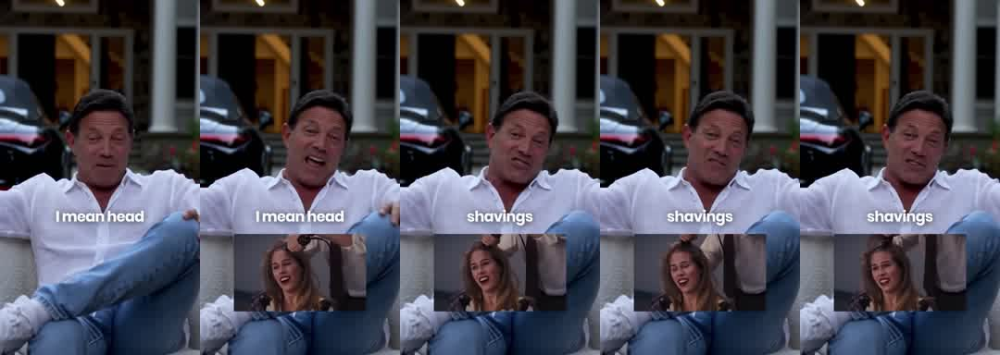

# v06_s13 · insert_image · 47.0–48.2s (calidad 4)

- **Guion:** I mean, head shavings,
- **Qué se ve:** Foto/fotograma rectangular (una mujer riendo sentada en sillón de barbería, de la película) bajo el subtítulo 'I mean head' (observado 46.9–47.3).
- **Diseño:** Subtítulo blanco Poppins-like bold centrado a ~61 % del alto; sin palabra destacada ni amarillo.
- **Efectos:** Sin texturas añadidas; grade natural cálido de atardecer (fondo #090705/#302F2E, piel cálida, camisa blanca ligeramente azulada #AAB2D1); fondo desenfocado por profundidad de campo (casa con columnas blancas, coche negro). Imagen sin borde ni sombra.
- **Animación:** Entra cut-in en 47.20 (antes de 'head' 47.40), sin animación; se reemplaza por el chimpancé en 48.37.
- **Por qué aquí:** Literal: 'head shavings' (escena del rapado en la película).
