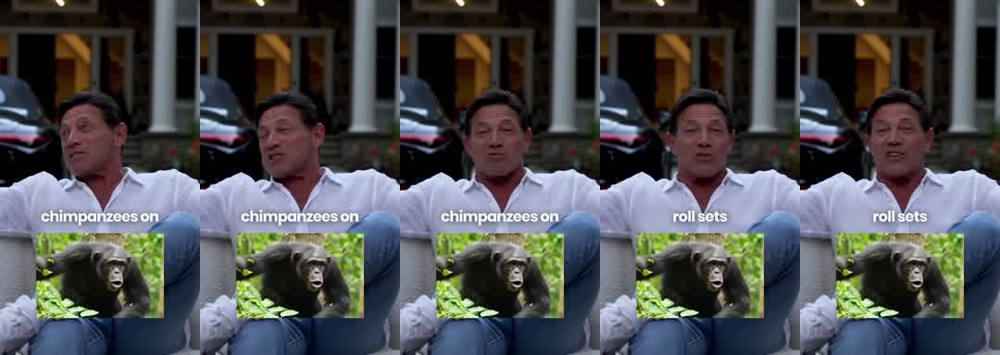

# v06_s14 · insert_image · 48.8–50.0s (calidad 4)

- **Guion:** chimpanzees on roll sets,
- **Qué se ve:** Foto de un chimpancé en vegetación (stock) bajo el subtítulo 'chimpanzees on' (observado 48.0–48.6; el bloque siguiente no se verificó).
- **Diseño:** Subtítulo blanco Poppins-like bold centrado a ~61 % del alto; sin palabra destacada ni amarillo.
- **Efectos:** Sin texturas añadidas; grade natural cálido de atardecer (fondo #090705/#302F2E, piel cálida, camisa blanca ligeramente azulada #AAB2D1); fondo desenfocado por profundidad de campo (casa con columnas blancas, coche negro). Foto stock saturada verde, sin borde.
- **Animación:** Swap seco 48.37 (0.43 s ANTES de 'chimpanzees' 48.80); sale en 50.20.
- **Por qué aquí:** Literal: nombra el animal → lo muestra; absurdo = humor.
