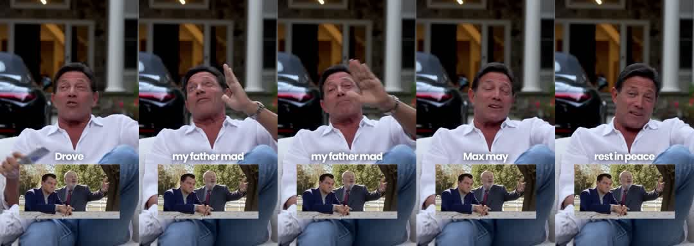

# v08_s05 · insert_image · 13.8–16.6s (calidad 4)

- **Guion:** drove my father Mad Max, made me rest in peace.
- **Qué se ve:** Fotograma de la película (DiCaprio y el actor que hace de su padre 'Mad Max' sentados en exterior) en rectángulo bajo el subtítulo 'Drove' / 'my father mad' / 'Max may'.
- **Diseño:** Mismo set que v06: sentado en sofá blanco exterior, camisa blanca y vaqueros, casa con columnas y coche negro desenfocados detrás. Subtítulo blanco centrado y≈63 %, sin amarillo.
- **Efectos:** Sin texturas; grade natural de atardecer (#0A0705/#302F2E, camisa blanca-azulada); fotos insertadas planas sin borde ni sombra.
- **Animación:** Entra con jump cut 13.73 (−0.05 s antes de 'drove'); sale con jump cut 17.07.
- **Por qué aquí:** Literal: nombra al padre → muestra al personaje de la peli que el público conoce.
