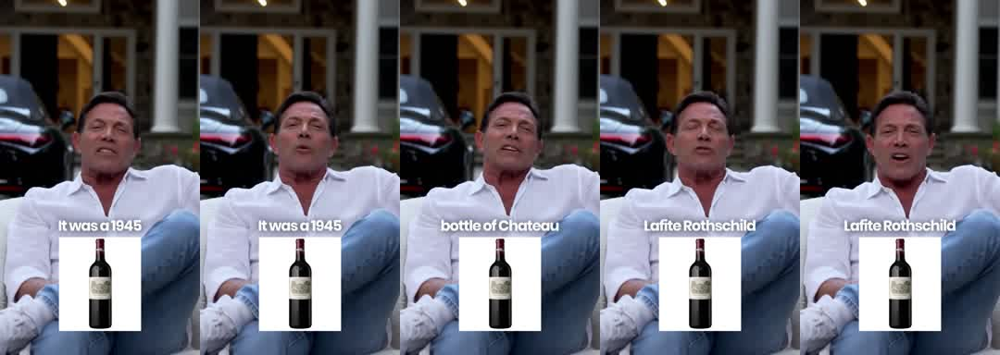

# v08_s11 · insert_image · 30.0–33.2s (calidad 4)

- **Guion:** It was a 1945 bottle of Chateau Lafite Rothschild.
- **Qué se ve:** Foto de botella de vino tinto (Château Lafite) sobre cuadrado blanco bajo 'It was a 1945' / 'Lafite Rothschild'.
- **Diseño:** Mismo set que v06: sentado en sofá blanco exterior, camisa blanca y vaqueros, casa con columnas y coche negro desenfocados detrás. Subtítulo blanco centrado y≈63 %, sin amarillo.
- **Efectos:** Sin texturas; grade natural de atardecer (#0A0705/#302F2E, camisa blanca-azulada); fotos insertadas planas sin borde ni sombra.
- **Animación:** Entra con jump cut 29.97; sale con jump cut 33.20.
- **Por qué aquí:** Literal: producto de lujo nombrado = foto del producto.
