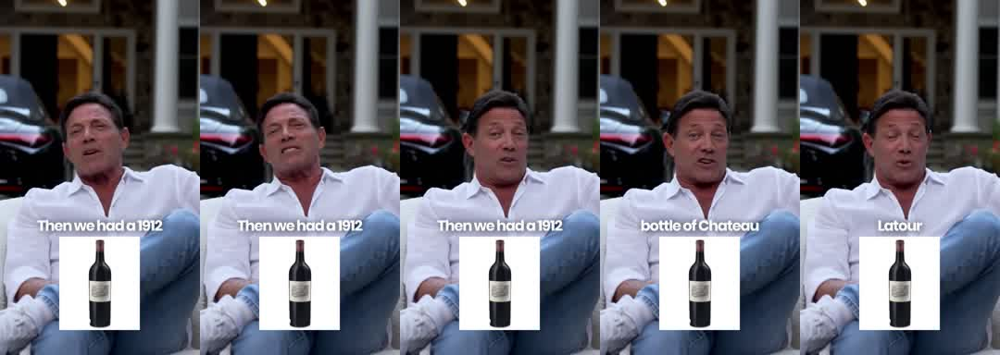

# v08_s13 · insert_image · 35.0–38.0s (calidad 4)

- **Guion:** Then we had a 1912 bottle of Chateau La Tour,
- **Qué se ve:** Segunda botella sobre cuadrado blanco: 'Then we had a 1912' / 'bottle of Chateau' / 'Latour'.
- **Diseño:** Mismo set que v06: sentado en sofá blanco exterior, camisa blanca y vaqueros, casa con columnas y coche negro desenfocados detrás. Subtítulo blanco centrado y≈63 %, sin amarillo.
- **Efectos:** Sin texturas; grade natural de atardecer (#0A0705/#302F2E, camisa blanca-azulada); fotos insertadas planas sin borde ni sombra.
- **Animación:** Jump cut 34.97 / 38.20.
- **Por qué aquí:** Literal; repite el mismo marco para la lista.
