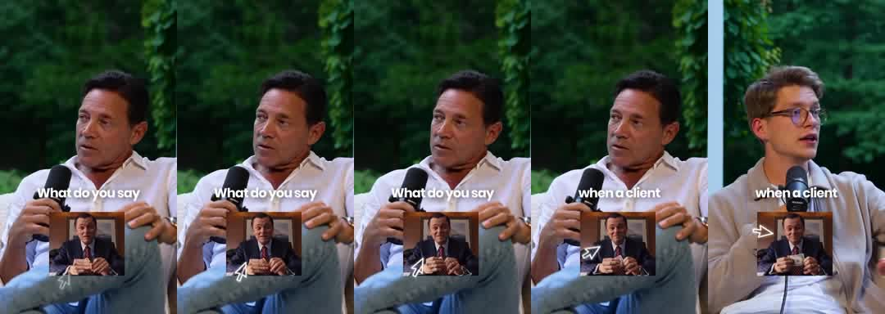

# v11_s01 · insert_image · 0.0–1.0s (calidad 4)

- **Guion:** What do you say when a client
- **Qué se ve:** [observado 0.0] Exterior tipo porche: Jordan sentado en sillón blanco con camisa blanca y micro negro, fondo de seto verde. Abajo-centro, recuadro con fotograma de 'El lobo de Wall Street' (DiCaprio en traje enseñando un billete) y un cursor/flecha blanca que se desplaza sobre él. Caption blanco 'What do you say' → 'when a client'.
- **Diseño:** Caption: sans geométrica extra-bold (tipo Poppins ExtraBold), minúsculas tal como se habla, blanco #FFFFFF, ~3.5 % del alto, centrada a ~61 % del alto (pecho), ancho ~45 %. Recuadro: rectángulo sin redondeo apreciable, ~42 % del ancho, centro x≈49 %, y≈67–88 % del alto, borde oscuro fino de la propia imagen.
- **Efectos:** Sombra suave oscura bajo las letras (no se ve contorno grueso). Grado natural saturado: verdes #0B2A11, piel cálida. Clip insertado con su propio grado cálido/teal.
- **Animación:** [observado 0.0–0.3] El cursor (flecha blanca con borde negro) se desplaza de izquierda a derecha sobre el recuadro ~0.3 s, como si 'pinchara' el clip. Caption cambia por bloque (corte seco de texto).
- **Por qué aquí:** [inferido] Hook: la pregunta de objeción ('too expensive') se ilustra desde el frame 0 con la película que da nombre a la marca; el cursor convierte el clip en algo 'clicable' y retiene la mirada.
