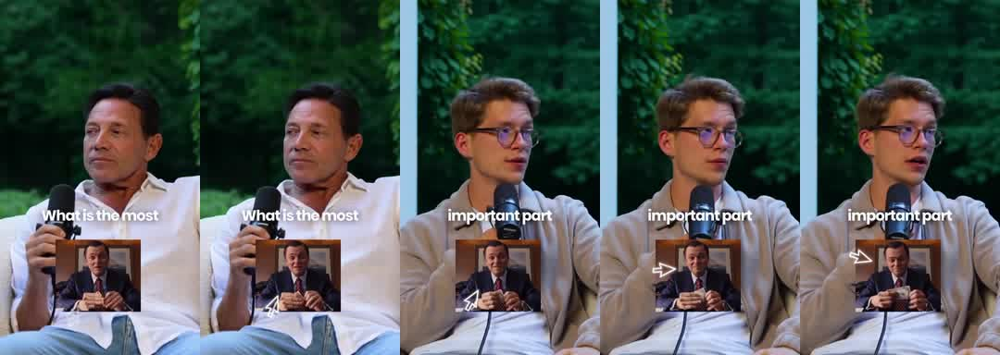

# v13_s01 · insert_image · 0.0–1.2s (calidad 4)

- **Guion:** What is the most important part
- **Qué se ve:** [observado 0.0–0.5] Jordan en el porche escuchando, recuadro con fotograma de 'El lobo de Wall Street' (DiCaprio en traje con billetes) abajo-centro y cursor-flecha blanca. [observado 0.5] corte al entrevistador que pregunta. Caption 'What is the most' / 'important part'.
- **Diseño:** Caption blanco extra-bold tipo Poppins, minúsculas, ~3 % alto, centro y≈61 %. Recuadro ~42 % ancho, x≈27–70 %, y≈67–88 %.
- **Efectos:** Grado natural, verdes saturados; sombra suave en texto.
- **Animación:** [observado 0.0–0.6] el cursor se desliza sobre el recuadro (izq.→der. y vuelta), recuadro persiste a través del corte 0.5.
- **Por qué aquí:** [inferido] Mismo hook de plantilla que v11: la película como 'thumbnail clicable' + pregunta en boca del entrevistador.
