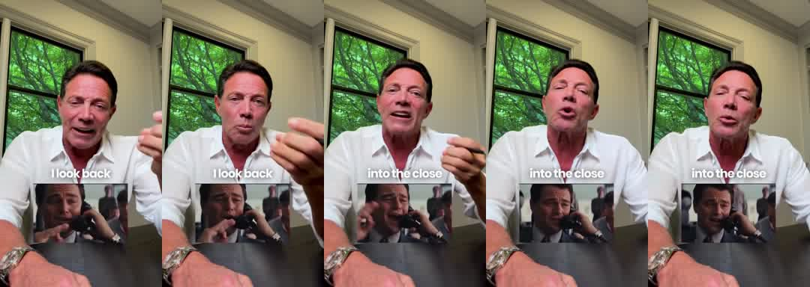

# v16_s12 · insert_image · 34.2–35.6s (calidad 4)

- **Guion:** I loop back into a close
- **Qué se ve:** [observed 34.23–35.94] Recuadro con clip de la película (DiCaprio al teléfono cerrando una venta) bajo el subtítulo, sobre el A-roll. Subtítulo 'I look back' (error de transcripción de 'loop back'), 'into the close'.
- **Diseño:** Recuadro rectangular sin borde x 21–79 %, y 64–84 % (≈58 % del ancho), centrado bajo el subtítulo.
- **Efectos:** Grado de película sin tratar.
- **Animación:** [observed] Aparece de golpe en 34.23 (con 'loop' 34.26) y desaparece de golpe en 35.94.
- **Por qué aquí:** [inferred] Literal: 'close' = la escena de cierre telefónico icónica de la película.
