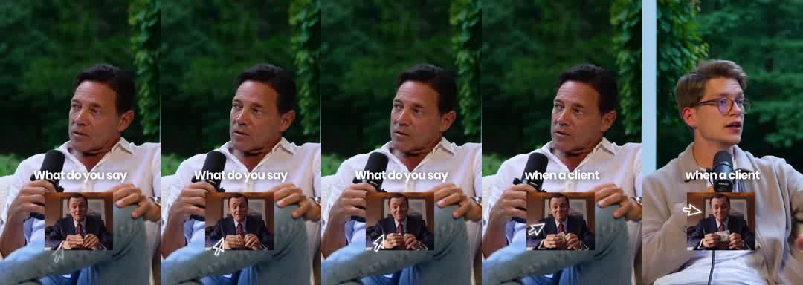

# v17_s01 · insert_image · 0.0–1.0s (calidad 4)

- **Guion:** What do you say when a client
- **Qué se ve:** [observed 0.0–1.0] Set de podcast exterior (vegetación de fondo, sofá blanco): Jordan con micrófono de mano negro, de perfil a 3/4. Bajo el subtítulo, foto de la película (DiCaprio en despacho con billetes) en recuadro, con un cursor-flecha blanco animado que entra desde abajo y 'hace click'.
- **Diseño:** Subtítulo blanco bold sans geométrica (tipo Poppins Bold) sentence case, cap ≈3 % del alto, y≈61 %. Recuadro foto x28–70 % (≈42 % del ancho), y67–88 %, rectangular sin borde. Cursor flecha blanca con contorno negro ≈6 % ancho.
- **Efectos:** Grado cálido-verde natural, fondo con desenfoque de profundidad; sin textura.
- **Animación:** [observed] Foto presente desde el frame 0; el cursor se mueve de abajo-izq hacia la foto 0.0–0.8 s y luego queda a su izquierda (1.0–2.3). Subtítulo con reemplazo duro.
- **Por qué aquí:** [inferred] Hook visual: la foto del Wolf con dinero + cursor 'cliqueando' sugiere 'mira esto' mientras plantea la objeción.
