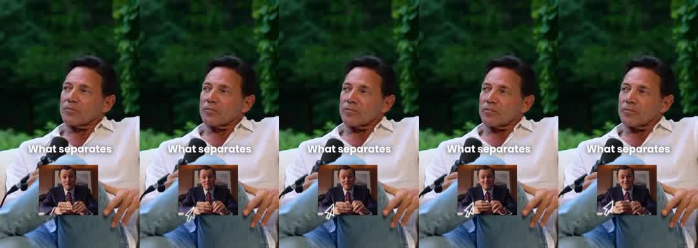

# v19_s01 · insert_image · 0.0–0.6s (calidad 3)

- **Guion:** What separates
- **Qué se ve:** [observed 0.0–0.67] Podcast exterior (mismo set que v17): Jordan con micro; foto de la película (DiCaprio con billetes) en recuadro bajo el subtítulo con cursor flecha animado.
- **Diseño:** Subtítulo blanco Poppins-like bold ≈3 % alto, y≈61 %. Recuadro x28–70 %, y67–88 % (42 % ancho).
- **Efectos:** Grado natural verde/cálido; sin textura.
- **Animación:** [observed] Foto desde el frame 0; cursor sube desde abajo-izq hacia la foto (0.0–1.1).
- **Por qué aquí:** [inferred] Hook visual reutilizado de la serie: imagen del Wolf + cursor.
