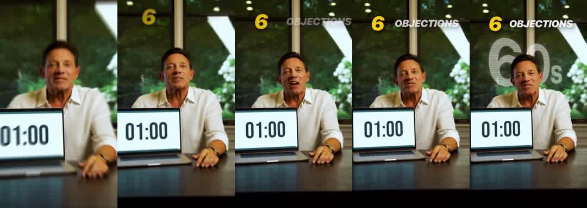

# v14_s01 · list_number · 0.0–1.2s (calidad 5)

- **Guion:** Six objections in
- **Qué se ve:** [observado 0.0–1.2] Estudio (mismo set que v12): Jordan de frente en mesa negra, ventanal con árboles; delante, un portátil abierto cuya pantalla muestra una cuenta atrás '01:00'. Arriba-izq.: '6' amarillo + 'OBJECTIONS' blanco.
- **Diseño:** '6' amarillo #F8CC12 aprox., ITÁLICA extra-bold, ~5 % alto, x≈4–9 %, y≈3–8 %; 'OBJECTIONS' blanco ITÁLICA MAYÚSCULAS ~2.5 % alto a su derecha. Temporizador: dígitos condensados oscuros (tipo Bebas/Oswald) sobre pantalla blanca, pantalla ≈ x 0–55 %, y 52–75 %.
- **Efectos:** Grado cálido, verdes saturados; sin textura.
- **Animación:** [observado 0.0–0.2] zoom-out brusco ~1.3→1.0. [observado 0.27] '6' pop; 'OBJECTIONS' write-on gris→blanco 0.53–0.67.
- **Por qué aquí:** [inferido] Hook de reto: número + límite de tiempo visible (cronómetro real en pantalla) prometen densidad.
