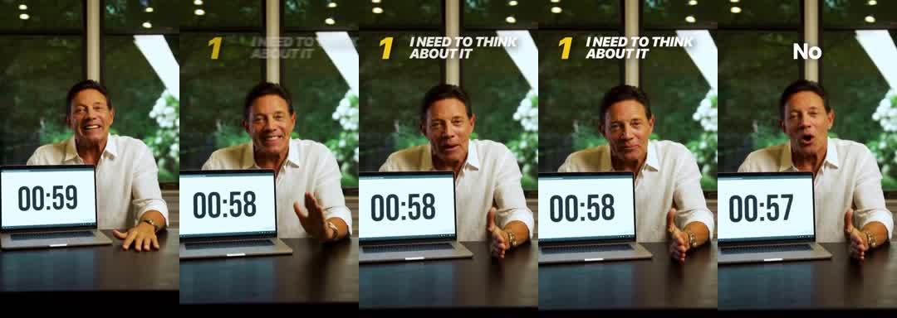

# v14_s03 · list_number · 2.2–3.3s (calidad 4)

- **Guion:** and you can think about it.
- **Qué se ve:** [observado 2.4–3.0] '1' amarillo + 'I NEED TO THINK ABOUT IT' blanco en dos líneas arriba-izq. Cronómetro 00:59→00:58.
- **Diseño:** Número amarillo ITÁLICA ~5 % alto x≈4–9 %; título blanco ITÁLICA MAYÚSCULAS 2 líneas ~2.2 % alto cada una, x≈12–55 %, y≈3–8 %.
- **Efectos:** Ninguno.
- **Animación:** [observado 2.25] jump-cut de escala; [observado 2.57] '1' entra con fade, título write-on gris→blanco ~0.2 s.
- **Por qué aquí:** [inferido] Objeción 1 citada como la diría el cliente (itálica = cita) y numerada para el progreso.
