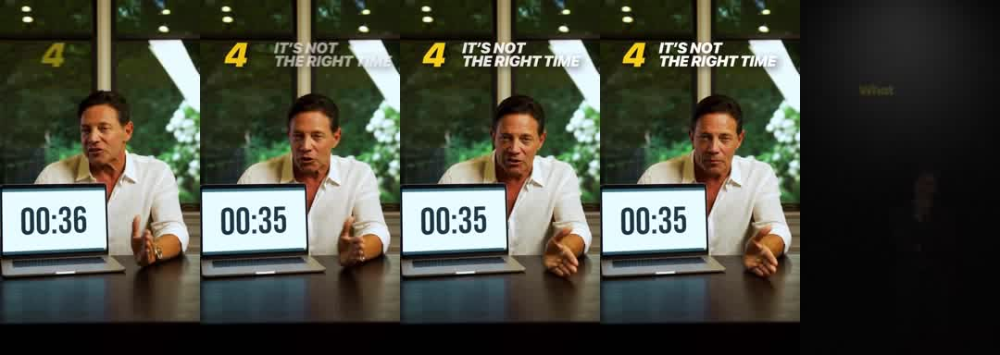

# v14_s12 · list_number · 20.8–22.0s (calidad 4)

- **Guion:** It's not the right time.
- **Qué se ve:** [observado 20.8–21.8] '4' amarillo + 'IT'S NOT THE RIGHT TIME' blanco itálica; a 21.9 todo funde a negro.
- **Diseño:** Igual que s03.
- **Efectos:** Fundido a negro al final.
- **Animación:** [observado 21.97–22.0] fade a negro en ~2 fr.
- **Por qué aquí:** [inferido] Objeción 4; el fundido introduce la escena 'conceptual'.
