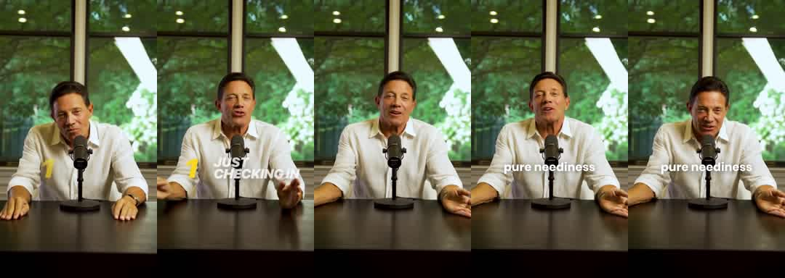

# v20_s04 · list_number · 5.4–8.4s (calidad 5)

- **Guion:** One, just check it in. Pure neediness.
- **Qué se ve:** [observed 5.6–7.0] '1' amarillo itálica grande a la izquierda + 'JUST / CHECKING IN' blanco itálica mayúsculas en 2 líneas; luego 'pure neediness' blanco.
- **Diseño:** Número ≈7 % alto, x≈10–20 %, y≈58–64 %; título 2 líneas ≈3 % alto cada una, alineado a la izquierda junto al número (x≈22–85 %).
- **Efectos:** Ninguno.
- **Animación:** [observed] Número fade+escala 5.4–5.6 en 'One'; título write-on 6.0 con 'just'. Pico de audio en la pausa tras 'One,' (−15.9 dB vs −30 dB de suelo) → probable SFX de impacto (inferred).
- **Por qué aquí:** [inferred] Estructura: cada punto se numera antes de nombrarse.
