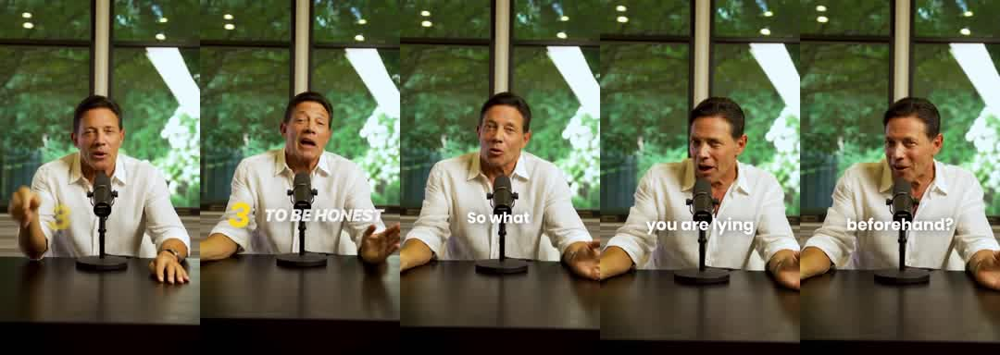

# v20_s08 · list_number · 18.5–21.9s (calidad 4)

- **Guion:** Three, to be honest. So what, you were lying beforehand?
- **Qué se ve:** [observed 18.48] reencuadre; '3' + 'TO BE HONEST' (1 línea); luego 'So what', 'beforehand?'.
- **Diseño:** Igual.
- **Efectos:** Ninguno.
- **Animación:** '3' 18.7; título 19.15.
- **Por qué aquí:** [inferred] Ítem 3.
