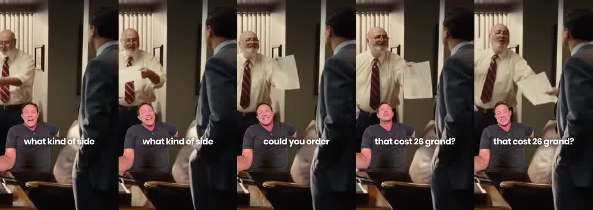

# v01_s11 · movie_clip · 36.1–40.2s (calidad 5)

- **Guion:** what kind of side dishes could you order that cost 26 grand?
- **Qué se ve:** Clip de la película (escena de oficina: hombre mayor con barba, camisa blanca y corbata granate agitando la cuenta; hombre de traje de espaldas a la derecha) a pantalla completa, con Jordan recortado (sin fondo) superpuesto abajo-izquierda riendo. (observado 35.9–40.3)
- **Diseño:** Clip a sangre completa 9:16 recortado del 16:9 original. Jordan recortado (máscara de silueta, sin recuadro ni borde): x 0–50 %, y ~49–81 %. Subtítulo blanco centrado a ~67 % sobre su pecho.
- **Efectos:** Grado cálido-oscuro propio de la película; leve desenfoque del clip; sin borde ni sombra en el recorte.
- **Animación:** Corte seco a 35.93 (en 'what' 36.1, −0.17 s); vuelve seco a A-roll a 40.40. Dura 4.5 s.
- **Por qué aquí:** Referencia a la escena real de la película mencionada ('that scene in the movie'): prueba/entretenimiento y autoridad de marca (inferido).
