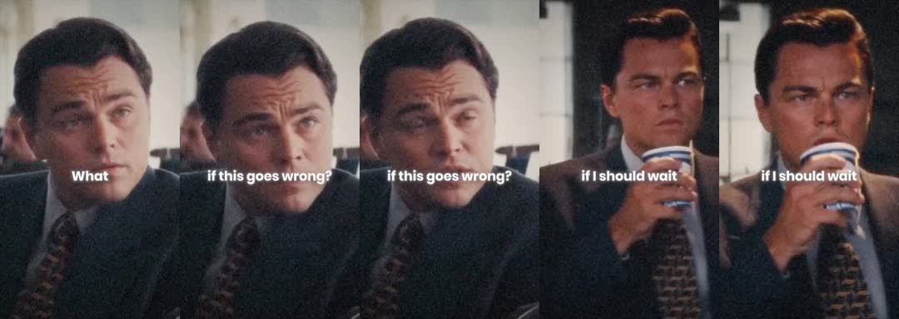

# v05_s05 · movie_clip · 9.4–11.6s (calidad 5)

- **Guion:** What if this goes wrong? What if I should wait?
- **Qué se ve:** Dos planos de la película (DiCaprio como Belfort): primer plano dudoso mirando arriba (9.34) y bebiendo café de vaso de papel (10.68). Subtítulos 'What' / 'if this goes wrong?' / 'if I should wait'. (observado 9.4–11.0)
- **Diseño:** Clips a sangre completa 9:16 (recorte del 16:9), sin recuadro ni él insertado; subtítulo blanco bold a ~55 %.
- **Efectos:** Grado cálido-dorado de la película; sin banda negra inferior.
- **Animación:** Cortes secos 9.34, 10.68, 11.76; 1 clip por pregunta (~1.2 s c/u).
- **Por qué aquí:** Dramatiza la voz interna del cliente con la película (inferido).
