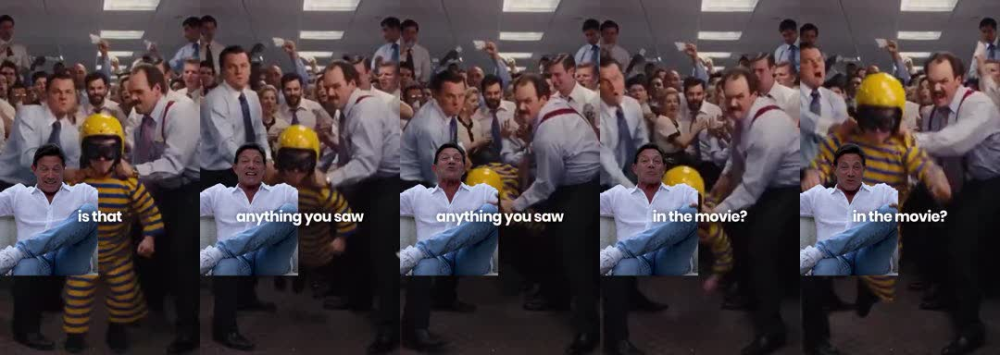

# v06_s11 · movie_clip · 42.6–44.4s (calidad 5)

- **Guion:** is that anything you saw in the movie,
- **Qué se ve:** Clip de la película El lobo de Wall Street a pantalla completa (oficina de Stratton, multitud, enano con casco amarillo y traje a rayas lanzado). Él en recuadro abajo-izquierda (su propio A-roll reducido). Subtítulo 'anything you saw' / 'in the movie?'.
- **Diseño:** Subtítulo blanco Poppins-like bold centrado a ~61 % del alto; sin palabra destacada ni amarillo. El subtítulo queda encima del borde superior del recuadro.
- **Efectos:** Clip con grade original de la película (fluorescente frío, gris-azulado); recuadro sin borde, sin sombra, sin esquinas redondeadas (observado).
- **Animación:** Corte seco 42.60 (scene score 0.55) dentro de 'is this, | is that'; sale con corte seco 44.97 en 'we'. Dura 2.37 s.
- **Por qué aquí:** Literal y prueba: dice 'la película' → muestra la escena real que todos recuerdan; el recuadro mantiene su presencia.
