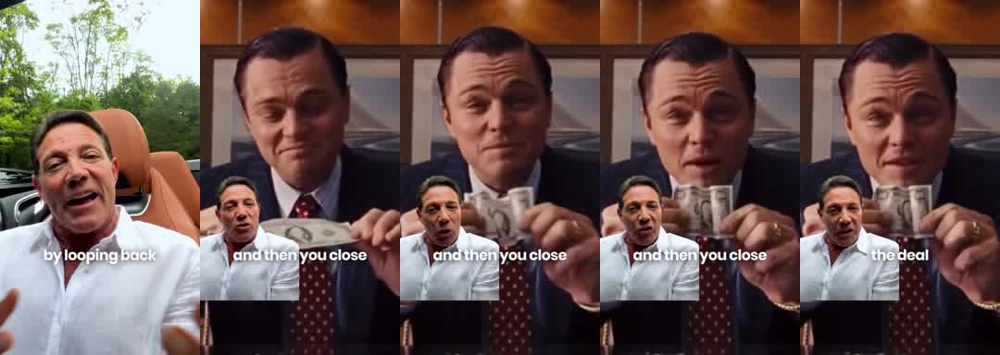

# v10_s17 · movie_clip · 42.6–44.3s (calidad 5)

- **Guion:** and then you close the deal.
- **Qué se ve:** Clip: DiCaprio sonriendo con un billete de dólar en las manos; él en recuadro. 'and then you close' / 'the deal'.
- **Diseño:** Full-bleed + recuadro.
- **Efectos:** Look cálido de la película.
- **Animación:** Corte seco 42.73 (a 'then' 42.90 −0.17); vuelta 44.47.
- **Por qué aquí:** Literal/metáfora: cerrar = dinero.
