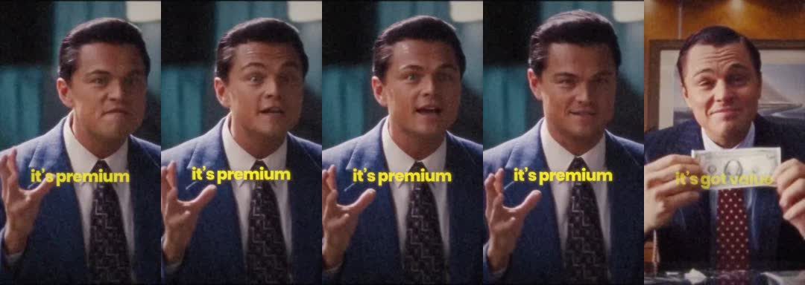

# v11_s10 · movie_clip · 17.6–18.7s (calidad 4)

- **Guion:** it's premium.
- **Qué se ve:** [observado 17.6–18.5] Clip de 'El lobo de Wall Street' a pantalla completa: DiCaprio en traje azul gesticulando ante fondo azul-gris. Caption amarillo 'it's premium'.
- **Diseño:** Caption de 1 línea AMARILLA extra-bold minúsculas ~5 % alto, ~45 % ancho, centro y≈61 %.
- **Efectos:** Clip con grado de la película (azules/teal, piel cálida), leve desenfoque por escalado a 9:16.
- **Animación:** [observado 17.57] Corte seco en 'it's'; caption entra con blur+escala ~2 fr (primer fotograma borroso) y se asienta.
- **Por qué aquí:** [inferido] Ilustración por personaje: la promesa 'premium' la dice el 'lobo' de la película → autoridad/meme y cambio de energía.
