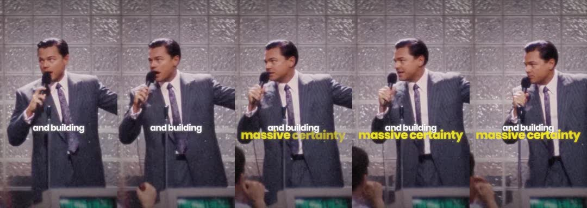

# v11_s17 · movie_clip · 31.6–33.2s (calidad 5)

- **Guion:** building massive certainty.
- **Qué se ve:** [observado 31.5–33.1] Clip: DiCaprio con micrófono de mano dando un discurso ante pared de bloques de vidrio. Caption 'and building' blanco + 'massive certainty' amarillo grande.
- **Diseño:** Línea 1 blanca ~3.5 %; línea 2 amarilla ~5 % alto, ancho ~80 %, y≈65 %.
- **Efectos:** Clip desaturado/frío (grises), viñeta leve de la propia película.
- **Animación:** [observado 31.8–32.4] write-on: 'massive' aparece amarillo en su palabra (31.88) y 'certainty' entra después (32.4); en un frame intermedio 'certainty' se ve gris/translúcido (gris→amarillo).
- **Por qué aquí:** [inferido] Frase-concepto de Belfort ('massive certainty') = discurso del lobo al equipo de ventas: literal + autoridad.
