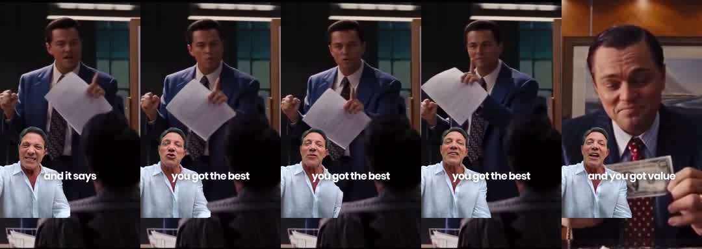

# v15_s08 · movie_clip · 17.0–18.7s (calidad 4)

- **Guion:** it says you got the best and
- **Qué se ve:** [observado 16.93–18.5] Clip 'El lobo de Wall Street': DiCaprio de pie con un papel arengando, contraplano con nuca; Jordan en recuadro abajo-izq. 'and it says' / 'you got the best'.
- **Diseño:** Subtítulo blanco ~3 % alto centrado y≈70 % (cruza el borde derecho del recuadro). Clip de película a pantalla completa; el selfie de Jordan reducido en un recuadro rectangular sin borde ni radio abajo-izquierda: x≈0–50 %, y≈51–87 % (~50 % del ancho), entra y sale en seco con el corte.
- **Efectos:** Clip con su grado original (azules/teal, cálidos); el recuadro de Jordan conserva el grado del móvil; sin sombra ni borde.
- **Animación:** [observado 16.933] corte seco a clip + PiP a la vez; sin animación de entrada.
- **Por qué aquí:** [inferido] 'You got the best' = el lobo en su mejor momento; el recuadro mantiene la conexión con el hablante.
