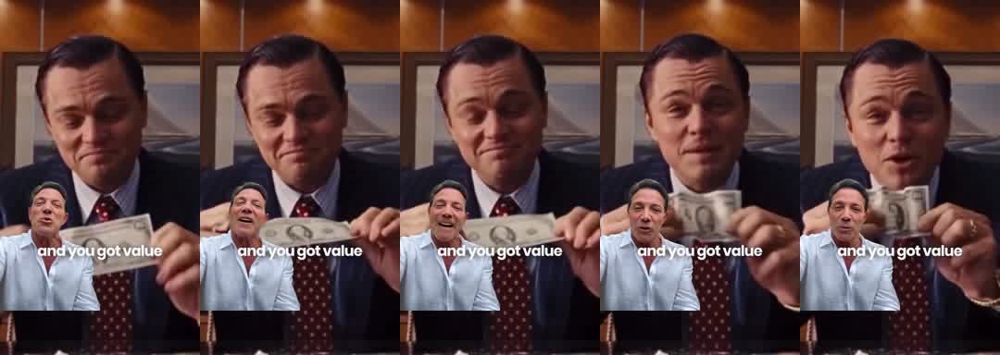

# v15_s09 · movie_clip · 18.7–19.7s (calidad 4)

- **Guion:** you got value.
- **Qué se ve:** [observado 18.57–19.6] Clip: DiCaprio frente a cámara con un billete de dólar; Jordan en recuadro. 'and you got value'.
- **Diseño:** Subtítulo blanco ~3 % alto centrado y≈70 % (cruza el borde derecho del recuadro). Clip de película a pantalla completa; el selfie de Jordan reducido en un recuadro rectangular sin borde ni radio abajo-izquierda: x≈0–50 %, y≈51–87 % (~50 % del ancho), entra y sale en seco con el corte.
- **Efectos:** Clip con su grado original (azules/teal, cálidos); el recuadro de Jordan conserva el grado del móvil; sin sombra ni borde.
- **Animación:** [observado 18.567] corte seco entre clips; el recuadro no se mueve.
- **Por qué aquí:** [inferido] Literal: value = billete (mismo clip que v11).
