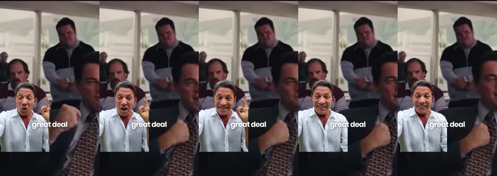

# v15_s15 · movie_clip · 31.1–32.0s (calidad 4)

- **Guion:** great deal.
- **Qué se ve:** [observado 31.07–32.0] Clip: oficina con brokers (Jonah Hill de pie) y DiCaprio de espaldas; Jordan en recuadro. 'great deal'.
- **Diseño:** Subtítulo blanco ~3 % alto centrado y≈70 % (cruza el borde derecho del recuadro). Clip de película a pantalla completa; el selfie de Jordan reducido en un recuadro rectangular sin borde ni radio abajo-izquierda: x≈0–50 %, y≈51–87 % (~50 % del ancho), entra y sale en seco con el corte.
- **Efectos:** Clip con su grado original (azules/teal, cálidos); el recuadro de Jordan conserva el grado del móvil; sin sombra ni borde.
- **Animación:** [observado 31.067] corte seco a clip + PiP.
- **Por qué aquí:** [inferido] 'Great deal' = la sala de ventas cerrando tratos.
