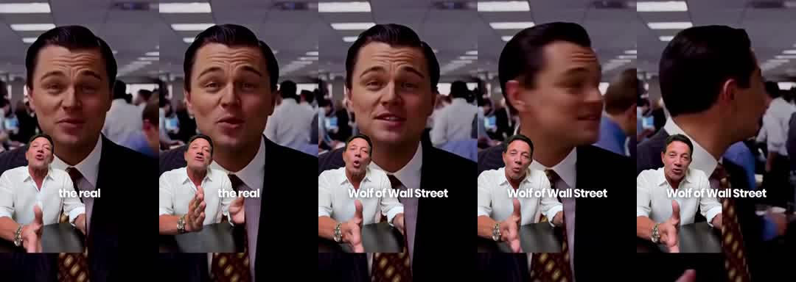

# v16_s03 · movie_clip · 4.8–6.1s (calidad 5)

- **Guion:** the real Wolf of Wall Street,
- **Qué se ve:** [observed 4.73–6.24] Clip de 'The Wolf of Wall Street' (DiCaprio sonriendo a cámara en la oficina de brokers, luego de espaldas) a pantalla completa; Jordan en recuadro abajo-izquierda sin borde. Subtítulo 'the real' / 'Wolf of Wall Street'.
- **Diseño:** Recuadro de Jordan x 0–54 %, y 48–90 % (≈54 % del ancho), rectangular sin borde ni sombra, recorte del A-roll. Subtítulo blanco bold baja a y≈68 %, encima del recuadro.
- **Efectos:** El clip conserva su grado de película (fríos azulados, contraste medio); sin textura añadida.
- **Animación:** [observed] Corte seco a 4.73 (en 'the' 4.78) y vuelta de corte seco a 6.24 (antes de 'and' 6.26). Recuadro aparece sin animación.
- **Por qué aquí:** [inferred] Literal: dice 'the real Wolf' y aparece el Wolf de Hollywood; prueba de autoridad y guiño cultural.
