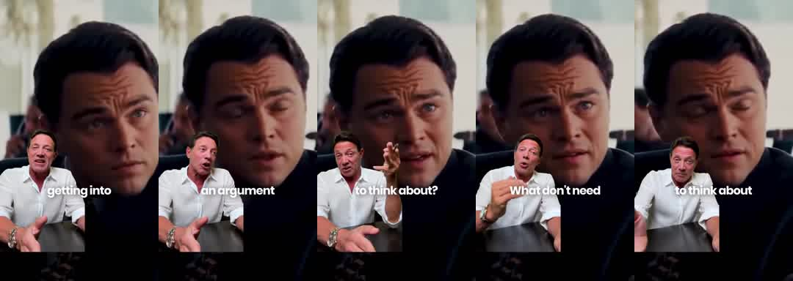

# v16_s07 · movie_clip · 15.2–18.7s (calidad 4)

- **Guion:** getting to an argument about what do you need to think about, what don't you need to think about?
- **Qué se ve:** [observed 15.33–18.93] Primer plano de DiCaprio serio/escéptico en la película (fondo claro) a pantalla completa; Jordan en el recuadro abajo-izquierda. Subtítulos 'getting into', 'an argument', 'to think about?', 'to think about'.
- **Diseño:** Recuadro x0–54 %, y48–90 %; subtítulo a y≈68 %.
- **Efectos:** Grado de película; piel cálida, fondo lavado.
- **Animación:** Cortes secos de entrada (15.33) y salida (18.93).
- **Por qué aquí:** [inferred] Metáfora/emoción: la cara de desconfianza ilustra la discusión que NO hay que tener.
