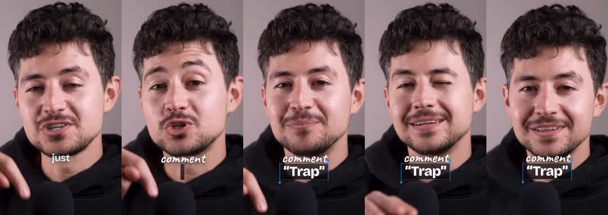

# v01_s15 · 14 Título - cierre - CTA · 30.3–32.4s (calidad 4)

- **Guion:** comment Trap down below and it'll DM you the link.
- **Qué se ve:** [obs] Nick a pantalla completa; aparece 'comment' en itálica caligráfica blanca y debajo '“Trap”' sans bold dentro de un marco de selección azul con asas.
- **Diseño:** [obs] 'comment' script/serif itálica (tipo brush) blanca ~3 % alto, y≈73 %; 'Trap' sans black ~4 % alto, relleno blanco→gris (degradado), dentro de caja azul translúcida con barras laterales y punto (igual que la caja del título), y≈76 %.
- **Efectos:** [obs] Degradado vertical blanco→gris en la palabra.
- **Animación:** [obs] 'comment' entra con blur+fade (30.3→30.4); 'Trap' entra en 30.6 con su caja de selección dibujándose; permanece hasta el final (32.66). Sin salida.
- **Por qué aquí:** [inf] CTA de palabra clave para automatización de DM: la palabra va en caja para que se copie tal cual.
