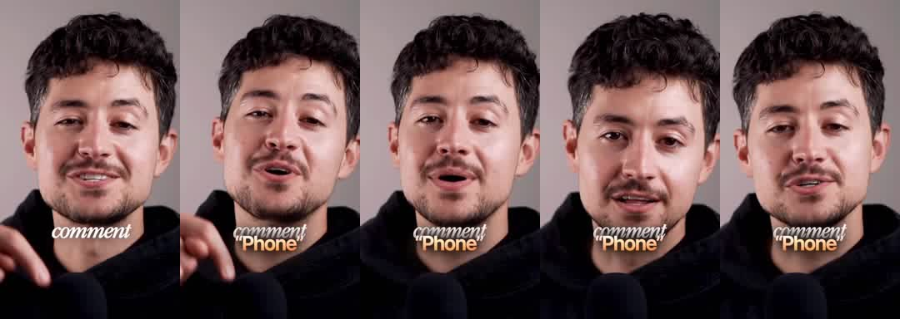

# v02_s13 · 14 Título - cierre - CTA · 22.1–24.5s (calidad 4)

- **Guion:** comment a phone down below and I'll send you all the links directly.
- **Qué se ve:** [obs] 'comment' en serif itálica blanca y debajo '“Phone”' sans black con degradado cálido (blanco→ámbar/naranja), solapadas.
- **Diseño:** [obs] 'comment' serif itálica (tipo Instrument Serif Italic) ~3 % alto, y≈71 %; 'Phone' sans black ~4 % alto, relleno degradado crema→naranja, y≈73–75 %; sin caja.
- **Efectos:** [obs] Degradado cálido en la palabra clave.
- **Animación:** [obs] 'comment' entra con blur/fade ~22.1; 'Phone' aparece 22.5; se mantiene hasta el final.
- **Por qué aquí:** [inf] CTA de palabra para DM automática; el degradado cálido conecta con el naranja del teléfono.
