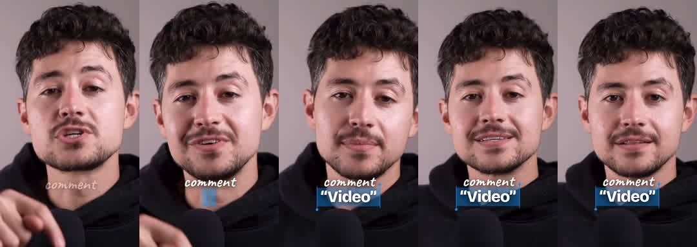

# v03_s16 · 14 Título - cierre - CTA · 35.6–37.6s (calidad 4)

- **Guion:** comment video down below, and I'll send you the link.
- **Qué se ve:** [obs] 'comment' en itálica caligráfica blanca y '“Video”' sans black blanca dentro de una caja azul translúcida con barras laterales y puntos (selección).
- **Diseño:** [obs] 'comment' ~2.5 % alto y≈69 %; 'Video' ~4 % alto, caja azul #1D85DC aprox., x 27.6–72.1 %, y≈71–75 %.
- **Efectos:** [obs] Ninguno.
- **Animación:** [obs] 'comment' gris→blanco con blur 35.7–35.8; caja + 'Video' aparecen ~36.2; hasta el final.
- **Por qué aquí:** [inf] Palabra clave para DM, en caja para copiarla.
