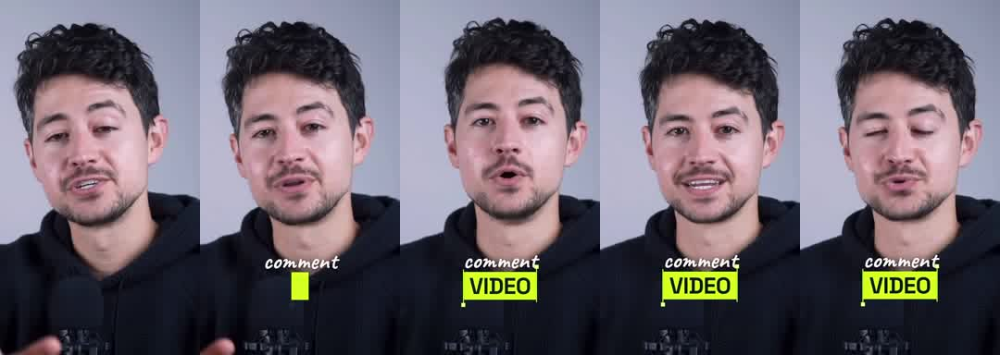

# v04_s15 · 14 Título - cierre - CTA · 27.4–29.1s (calidad 4)

- **Guion:** comment video and I'll send it to you directly.
- **Qué se ve:** [obs] 'comment' en itálica script blanca y 'VIDEO' sans bold MAYÚSCULAS negra dentro de caja lima con asas.
- **Diseño:** [obs] 'comment' y≈72 %; caja lima #C8F810 con 'VIDEO' negro ~4 % alto, y≈75–79 %, asa en esquina inferior-izq.
- **Efectos:** [obs] Ninguno.
- **Animación:** [obs] 'comment' gris→blanco 27.5; caja lima nace como barra (27.75) y se ensancha con 'VIDEO' (28.0).
- **Por qué aquí:** [inf] CTA; la caja lima conecta con el color del vídeo.
