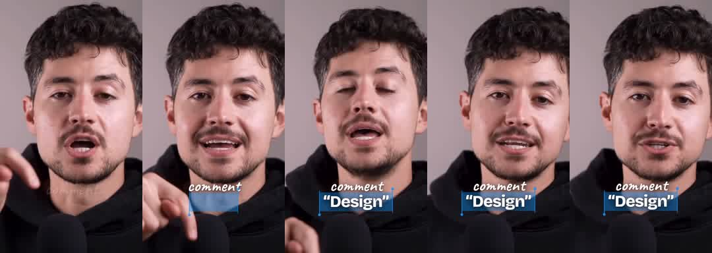

# v05_s16 · 14 Título - cierre - CTA · 37.7–39.8s (calidad 4)

- **Guion:** comment design down below, and I'll send you the link directly.
- **Qué se ve:** [obs] 'comment' itálica script blanca + '“Design”' sans black blanca en caja azul de selección con asas.
- **Diseño:** [obs] 'comment' y≈70 %; caja azul con barras y puntos, y≈72–76 %.
- **Efectos:** [obs] Ninguno.
- **Animación:** [obs] 'comment' gris→blanco ~37.75; caja azul vacía aparece 37.9 y el texto 'Design' entra ~38.25; hasta el final.
- **Por qué aquí:** [inf] CTA de palabra clave.
