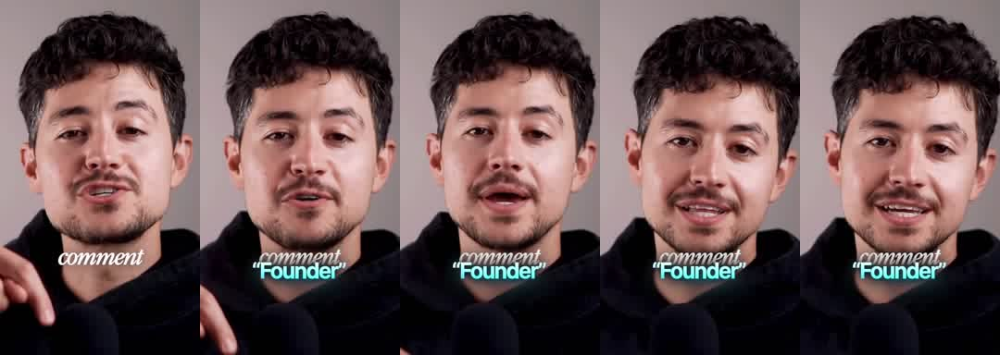

# v06_s21 · 14 Título - cierre - CTA · 42.9–45.5s (calidad 5)

- **Guion:** comment Founder down below and I'll DM you the link directly.
- **Qué se ve:** Él a pantalla completa; 'comment' serif itálica blanca pequeña encima de '"Founder"' sans bold con degradado blanco→cian y glow, se mantiene hasta el final. (observado 42.75–45.0)
- **Diseño:** 'comment' serif itálica ~4 % alto; 'Founder' sans bold ~5 % alto con degradado cian #7FE8FF→blanco y glow cian; bloque centrado a ~73–75 % y, solapado ligeramente.
- **Efectos:** Glow cian alrededor de la palabra clave.
- **Animación:** 'comment' aparece a 42.75 (≈0.1 s antes de la voz); 'Founder' entra con pop+fade a ~43.2 y queda fijo; el resto del guion no se subtitula. (observado)
- **Por qué aquí:** CTA de palabra clave: la palabra a comentar queda fija y brillante para recordarla.
