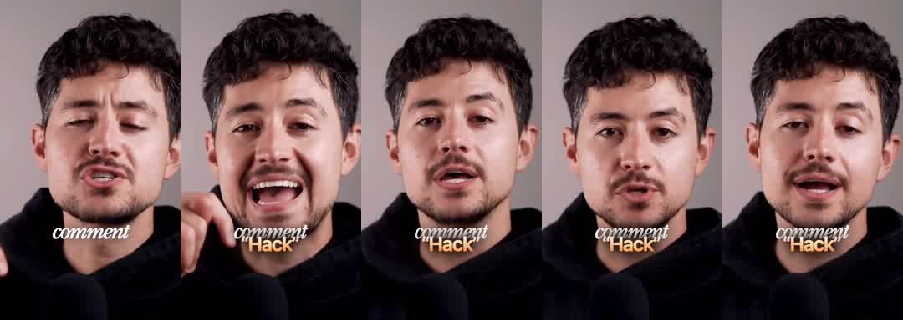

# v08_s16 · 14 Título - cierre - CTA · 31.5–34.5s (calidad 5)

- **Guion:** comment the word hack down below and I'll DM you the link directly.
- **Qué se ve:** 'comment' serif itálica blanca + '"Hack"' sans bold con degradado dorado/naranja y glow cálido, fijo hasta el final. (observado 31.5–34.25)
- **Diseño:** Bloque a y≈74–79 %, 'Hack' ~5 % alto, degradado blanco→naranja #E8A060 aprox.
- **Efectos:** Glow naranja (coherente con el bokeh del video).
- **Animación:** 'comment' 31.5; 'Hack' pop+fade a 32.0.
- **Por qué aquí:** Palabra a comentar en el color del video.
